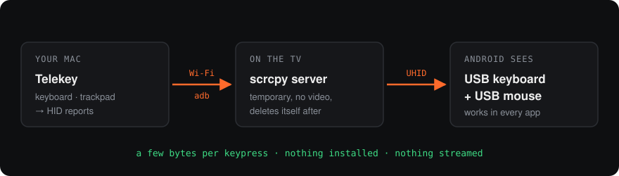

# Contributing to Telekey

Thanks for helping. Telekey is a small Mac app that controls Android TV and Google TV, and every TV brand behaves a little differently, so reports from real TVs matter as much as code.

## Ways to help

| You can… | How |
|:--|:--|
| Report a bug | [Open an issue](https://github.com/dubey2k/telekey/issues/new) with the details listed [below](#reporting-a-bug). |
| Add bloat for your TV brand | Send package names with a one-line description each. They go in `Sources/Bloat.swift`. |
| Fix a known issue | Pick one from [KNOWN_ISSUES.md](KNOWN_ISSUES.md). Each one says where the problem is and which fix we'd take. |
| Add a keyboard layout | Non-US layouts go in `hidUsage` in `Sources/Remote.swift`. |
| Something bigger | Open an issue first so we can agree on the approach before you write it. |

## Build it

You need macOS 14 or newer and the command line tools from Xcode 16 or newer (`xcode-select --install`), for the Swift 6 compiler. There's no Xcode project and no Swift packages.

```sh
./build.sh                 # makes build/Telekey.app and dist/Telekey.zip
open build/Telekey.app
```

The first build downloads two files into `vendor/` and checks them against pinned SHA-256 hashes: `adb` (from Android platform-tools) and `scrcpy-server`. After that, builds work offline.

Every build first runs `Tests/checks.swift`. It tests the command runner (output, exit status, timeouts, cancellation), quoting and input validation, and stops the build if anything fails. The app compiles in **Swift 6 language mode**, so data races are compile errors. Keep the build free of warnings.

> [!TIP]
> If `swiftc` fails with hundreds of errors from `/usr/local/include`, an old install left C headers there. `build.sh` passes `-sdk` to avoid it. Pass `-sdk "$(xcrun --show-sdk-path)"` too if you compile by hand.

## Where things are

| File | What's in it |
|:--|:--|
| `Sources/App.swift` | Window, menus, and the event monitor that captures your input |
| `Sources/Discovery.swift` | Finding TVs: Google Cast, adb mDNS, port 5555 |
| `Sources/Model.swift` | The TV list, pairing, connecting, reconnecting |
| `Sources/Link.swift` | Starts scrcpy's server on the TV and speaks its control protocol |
| `Sources/Remote.swift` | Turns keyboard, trackpad and scroll events into HID reports and ⌘ shortcuts |
| `Sources/TV.swift` | Everything in the tabs: apps, Private DNS, links, storage, screenshots |
| `Sources/Bloat.swift` | Which apps are suggested for removal, and which are protected |
| `Sources/Configs.swift` | Saved settings, one entry per TV |
| `Sources/Shell.swift` | Running adb, input validation, quoting |
| `Sources/UI/` | SwiftUI views. `Components.swift` holds the theme and shared pieces |
| `Tests/checks.swift` | Checks that `build.sh` runs before every build |
| `docs/` | README images. `icon.swift` draws the app icon |

## How control works

<p align="center"></p>

1. **Connect.** `adb connect` to the TV, on port 5555 if it's open, otherwise through Wireless debugging. Telekey runs its own adb server on port 5038, so it never interferes with Android Studio or your Terminal's adb.
2. **Start the server.** Push `scrcpy-server` to `/data/local/tmp` and start it with `video=false audio=false`. Nothing is streamed, which is why input feels instant.
3. **Create the devices.** Forward a local port to the server's socket and send `UHID_CREATE` twice, once for a keyboard and once for a mouse. Android sees two real USB devices.
4. **Send input.** Every key and pointer move becomes a `UHID_INPUT` report. Remote buttons use `INJECT_KEYCODE`.

The message format is defined in scrcpy's `app/src/control_msg.c` and changes between versions. If you bump `SCRCPY` in `build.sh`, check `Link.swift` against the new version.

## House rules

- **Give every adb call its TV.** Use `adb(device, …)` and `shell(device, …)` with the session's serial. There's no global "current TV".
- **Keep the main thread free.** Anything that blocks (pipes, sockets) goes through `run()` or `background { }`.
- **Validate everything that reaches `adb shell`.** Package names go through `validPackage`, hosts through `validHost`, free text through `quoted()`. A link or an app name is user input.
- **Ask before destroying anything.** Removing apps, clearing data and restarting all show a confirmation. Keep it that way.
- **No new dependencies.** No Swift packages, nothing users have to install. AppKit, SwiftUI, Network and the two bundled binaries are the whole stack.
- **Keep the look.** Flat graphite surfaces and one orange accent. No glass, blur or shadows. Use `Theme`, the `Flat` button style and `plate()`.
- **Test on a real TV.** Scrolling and app lists differ between brands, and an emulator hides that.

## Before you open a pull request

- [ ] `./build.sh` finishes with no errors or warnings, and the checks pass
- [ ] You tested on a real TV, and the PR says which one (brand, model, Android version)
- [ ] New shell commands validate or quote their input
- [ ] The PR does one thing. Small PRs get reviewed fast.

## Reporting a bug

Copy this into your issue:

```
Mac:         (model, macOS version)
TV:          (brand, model, Android version)
Telekey:     (Telekey menu → About Telekey)
What I did:
What happened:
What I expected:
```

For connection problems, also paste the output of:

```sh
ANDROID_ADB_SERVER_PORT=5038 /Applications/Telekey.app/Contents/Resources/adb devices -l
```
