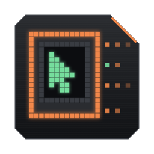
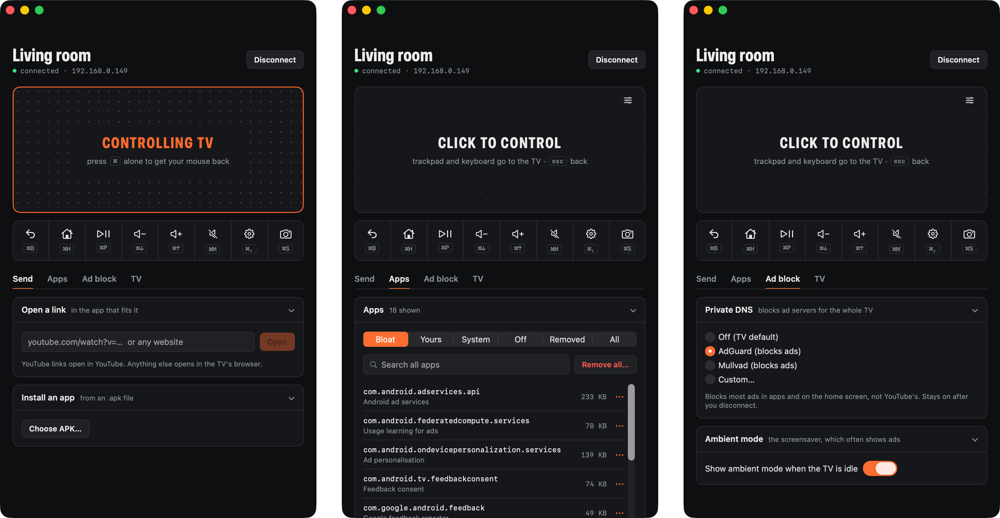

<p align="center"></p>

# Telekey

Your Mac's keyboard and trackpad, on your Android TV. Over Wi-Fi, with nothing installed on the TV.

Click the pad, and the TV gets a real mouse pointer and a real keyboard. Type a search instead of pecking letters with a remote. Paste a link from your Mac and it opens in the right app. Remove the junk your TV maker preinstalled. Press ⌘ to get your mouse back.



## Why this and not…

| | Typing | Pointer | On the TV | Lag | Also |
|---|---|---|---|---|---|
| **Telekey** | Mac keyboard | Mac trackpad | nothing | none you'll notice (no video stream) | open links, remove bloat, ad-blocking DNS |
| Google TV phone remote | phone keyboard | no | nothing | low | needs your phone in hand |
| scrcpy | yes | yes | nothing | video over Wi-Fi, laggy | a terminal command, mirrors the screen |
| Mouse-cursor apps (Mouse Toggle, MATVT) | remote | D-pad moves a cursor | an app | low | slow to aim |
| Bluetooth keyboard + touchpad | yes | yes | nothing | none | costs money, another gadget on the couch |

Telekey never streams the screen. You look at the TV; the Mac only sends keys and pointer moves, a few bytes each, so it feels like a mouse plugged into the TV.

## Install

1. Download `Telekey.zip` from [Releases](https://github.com/dubey2k/telekey/releases), unzip, drag **Telekey** to Applications.
2. Open it. macOS says it can't verify the developer (the app isn't notarized yet). Go to **System Settings → Privacy & Security**, scroll down, click **Open Anyway**. Once.
3. Allow **Local Network** when asked. That's how it finds your TV.

Or in Terminal, which skips step 2:

```sh
curl -fsSL https://github.com/dubey2k/telekey/releases/latest/download/Telekey.zip -o /tmp/Telekey.zip \
  && ditto -x -k /tmp/Telekey.zip /Applications && open /Applications/Telekey.app
```

Needs macOS 14 or newer, Apple silicon or Intel. adb and scrcpy's server are inside the app; no Homebrew needed.

## Set up the TV (once)

1. **Settings → System → About**, click **Android TV OS build** 7 times. Developer options appear.
2. **Settings → System → Developer options**, turn on **USB debugging** and **Wireless debugging**.
3. Same Wi-Fi as the Mac. If your router can give the TV a fixed IP, do that; Telekey remembers TVs by IP.

Then in Telekey, pick the TV. First time only, type the code from **Wireless debugging → Pair device with pairing code**, or allow the Mac on the TV screen.

Many TVs (with USB debugging on) accept the connection again after sleep or a restart, without pairing. Telekey connects to the last TV by itself when you open it.

## Use

Click the dotted pad. It turns orange: the trackpad and keyboard now drive the TV. **⌘ on its own** gives the mouse back.

| | |
|---|---|
| Back | ⌘B, Esc, or two-finger click |
| Home | ⌘H |
| Play / pause | ⌘P |
| Volume, mute | ⌘↑ ⌘↓ ⌘M |
| TV settings | ⌘, |
| Screenshot to Desktop | ⌘S |
| Paste Mac clipboard on the TV | ⌘V (while controlling) |

Under the pad:

- **Send**: open a link on the TV (YouTube links open in YouTube), install an APK.
- **Apps**: every app with its size. Turn off, remove or restore apps, including preinstalled ones. **Bloat** suggests what's safe to remove. Apps the TV needs are locked.
- **Ad block**: Private DNS (AdGuard, Mullvad, or your own) blocks ad servers for the whole TV. Not YouTube's ads. Turn it off if an app stops loading.
- **TV**: storage, clear caches, animation speed, sleep, restart.

Pointer and scroll speed are per TV, under the slider icon on the pad.

## Known issues

- **Scrolling in some TV apps jumps back.** YouTube, JioHotstar and the home screen keep a highlighted item and pull the list back to it after a few rows. It happens with any mouse plugged into an Android TV. Use the arrow keys there.
- **US keyboard layout** only for now. Other layouts type the wrong symbols.
- **Bloat suggestions are tuned on TCL.** On other brands, check before removing. Removed preinstalled apps can be restored from **Removed**.
- **Can't wake a sleeping TV.** It's off the network.
- After a Wireless-debugging connect, Telekey also opens adb on port 5555 so the TV survives sleep. Anyone on your Wi-Fi still needs your TV to approve them, but if you share your network, keep that in mind.

Code-level issues, with fixes we'd welcome: [KNOWN_ISSUES.md](KNOWN_ISSUES.md).

## When it doesn't connect

- **No TVs found**: TV off, debugging not on, or a different Wi-Fi (guest networks often block devices from seeing each other).
- **Pairing failed**: the code expired. Reopen the pairing screen on the TV.
- **TV is on but won't connect**: click **Fix connection**. Check Telekey is allowed under **System Settings → Privacy & Security → Local Network**.

## Privacy

Everything stays between your Mac and your TV. No accounts, no analytics, no servers. The only outside service is the DNS provider, and only if you pick one. Settings live in `~/Library/Application Support/Telekey/tvs.json`.

## How it works

adb connects to the TV. Telekey copies scrcpy's server to the TV for the session and tells it to create a virtual USB keyboard and mouse, then sends HID reports for your keys and trackpad. No video, no audio. The server deletes itself when you disconnect. Details in [CONTRIBUTING.md](CONTRIBUTING.md).

Built on [scrcpy](https://github.com/Genymobile/scrcpy) and adb, both Apache 2.0. Telekey is [MIT](LICENSE).
