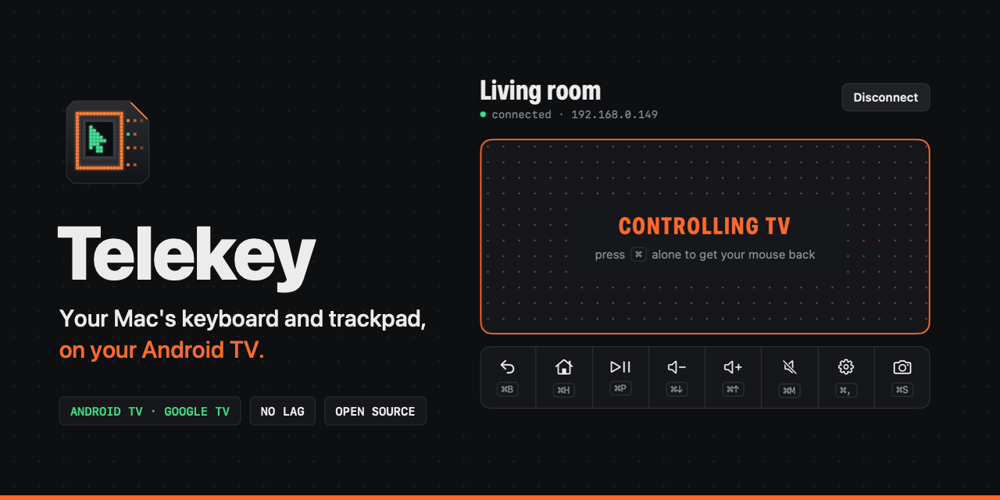
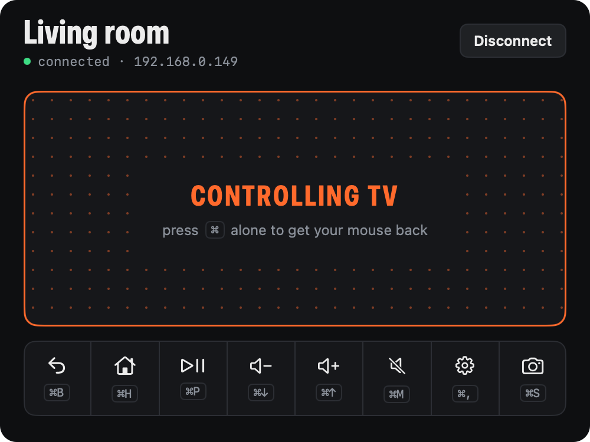
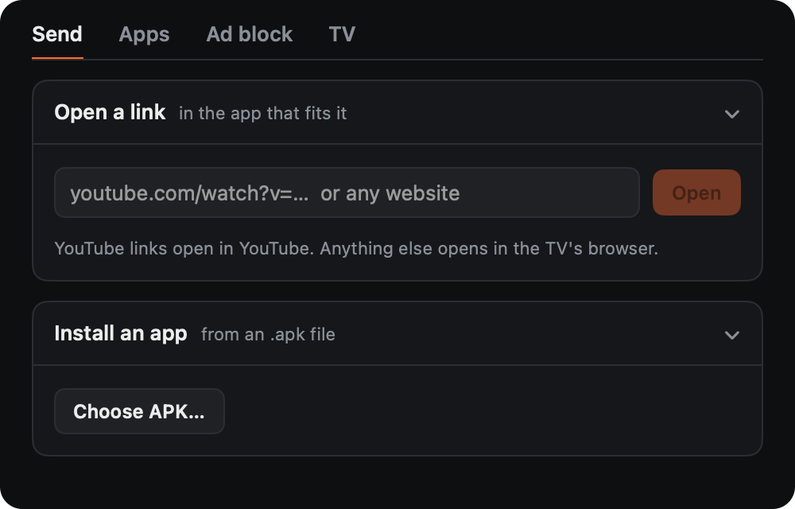
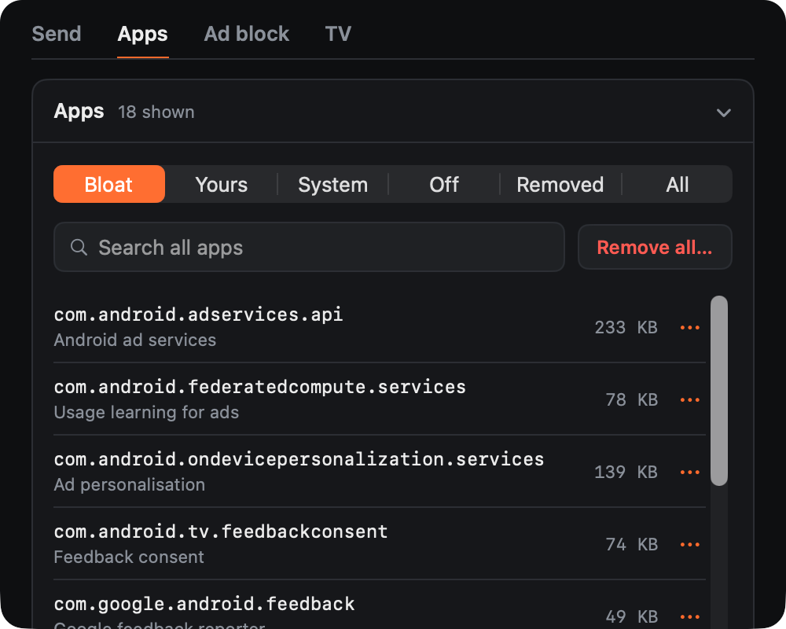
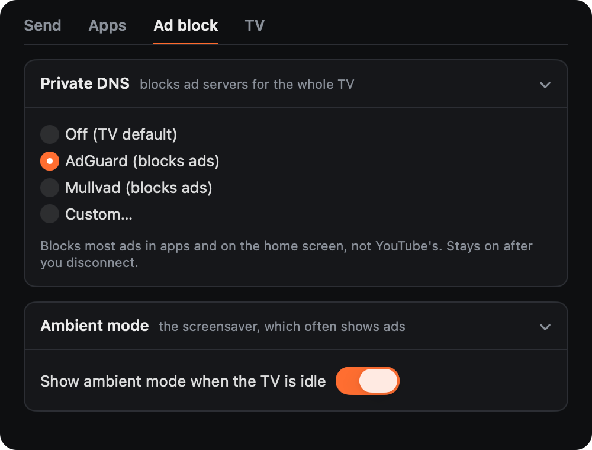
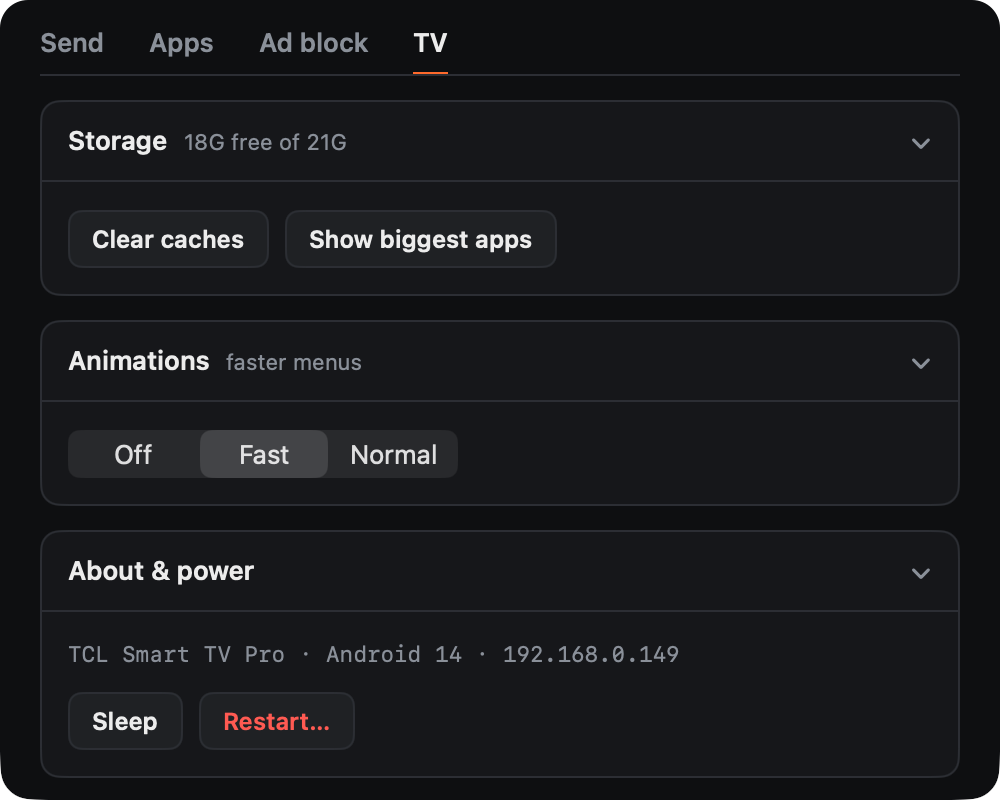
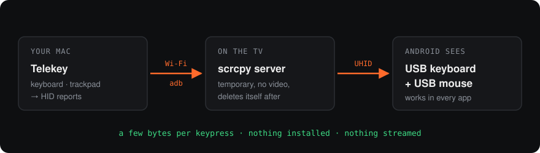

<p align="center"></p>

<p align="center">
  <a href="https://github.com/dubey2k/telekey/releases/latest"></a>
  
  
  
  
</p>

<p align="center">
  <a href="#install">Install</a> ·
  <a href="#set-up-your-tv">Set up your TV</a> ·
  <a href="#what-you-can-do">What you can do</a> ·
  <a href="#shortcuts">Shortcuts</a> ·
  <a href="#faq">FAQ</a>
</p>

Typing on a TV remote is miserable. One letter at a time, across an on-screen keyboard, for every search and every password.

**Telekey turns your Mac into the keyboard and mouse for your Android TV.** Click the pad in the app and your trackpad moves a real pointer on the TV. Your keyboard types straight into any app. Press <kbd>⌘</kbd> and you're back on your Mac. It all happens over Wi-Fi, and nothing gets installed on the TV.

> [!IMPORTANT]
> **Telekey is for Android TV and Google TV only.** That covers TCL, Sony, Philips, Hisense, Xiaomi, Chromecast with Google TV, Nvidia Shield and every other TV that runs Android TV.
> Samsung (Tizen), LG (webOS), Roku and Apple TV don't run Android, so it can't work with them. Fire TV runs Android and might work, but nobody has tested it yet.

## What you can do

###  Type and point, like it's a computer

Click the pad and it turns orange. From then on, your trackpad and keyboard belong to the TV.

- **A real pointer.** Click anything on screen. Scroll with two fingers.
- **A real keyboard.** Search YouTube, log into Netflix, fill in a Wi-Fi password. No on-screen keyboard.
- **Paste from your Mac.** Copy a long password on your Mac, press <kbd>⌘</kbd><kbd>V</kbd>, and it's typed on the TV.
- **The remote, on ⌘ keys.** Home, Back, play/pause and volume, plus a button row for each.

<p align="center"></p>

###  Send links and apps to the TV

- **Open a link** on the TV from your Mac. YouTube links open in the YouTube app, everything else in the TV's browser.
- **Install an APK** from your Mac. No USB stick, no file manager app.

<p align="center"></p>

###  Clear out the bloat

Your TV maker probably preinstalled ad services, "recommendation" apps and trackers you never asked for. The **Apps** tab lists every app with its size.

- **Bloat** shows what's safe to remove, with a plain-English line for each.
- Turn an app off, remove it, or bring a removed one back from **Removed**.
- Apps the TV needs to work are locked, so you can't break it by accident.

<p align="center"></p>

###  Block ads across the whole TV

Pick AdGuard or Mullvad (or your own DNS server) and the TV stops loading most ad servers, in every app and on the home screen. You can also turn off the ambient-mode screensaver, which often shows ads.

<p align="center"></p>

> [!NOTE]
> DNS blocking can't stop YouTube's own ads. They come from the same servers as the videos.

###  Keep the TV quick

See how much storage is left and which apps use it, clear every app's cache in one click, speed up menu animations, and put the TV to sleep or restart it.

<p align="center"></p>

###  And a few small things

- <kbd>⌘</kbd><kbd>S</kbd> saves a screenshot of the TV to your Desktop.
- Telekey finds TVs on your Wi-Fi by itself, and reconnects to the last one when you open it.
- Pointer and scroll speed are saved per TV.

## Why not just use…

|                              | **Telekey** | Phone remote app | scrcpy | Mouse-cursor app | Bluetooth keyboard |
| :--------------------------- | :---------: | :--------------: | :----: | :--------------: | :----------------: |
| Type on a real keyboard      |     ✅      |        ➖        |   ✅   |        ❌        |         ✅         |
| Real mouse pointer           |     ✅      |        ❌        |   ✅   |        ➖        |         ✅         |
| No lag                       |     ✅      |        ✅        |   ❌   |        ✅        |         ✅         |
| Nothing to install on the TV |     ✅      |        ✅        |   ✅   |        ❌        |         ✅         |
| Nothing to buy               |     ✅      |        ✅        |   ✅   |        ✅        |         ❌         |
| Open links on the TV         |     ✅      |        ❌        |   ❌   |        ❌        |         ❌         |
| Install APKs                 |     ✅      |        ❌        |   ✅   |        ❌        |         ❌         |
| Remove bloat, block ads      |     ✅      |        ❌        |   ❌   |        ❌        |         ❌         |

<sub>✅ yes · ➖ sort of (phone keyboard; D-pad-driven cursor) · ❌ no. scrcpy lags because it streams the TV's screen to your Mac. Telekey never streams video, it only sends your keys and pointer moves.</sub>

## Install

1. Download **Telekey.zip** from the [latest release](https://github.com/dubey2k/telekey/releases/latest) and unzip it.
2. Drag **Telekey** into Applications and open it.
3. macOS will say it can't check the developer, because the app isn't notarized yet. Open **System Settings → Privacy & Security**, scroll down and click **Open Anyway**. You only do this once.
4. Click **Allow** when macOS asks about your local network. That's how Telekey finds your TV.

> [!TIP]
> Comfortable in Terminal? This installs it and skips step 3:
>
> ```sh
> curl -fsSL -o /tmp/Telekey.zip \
>   https://github.com/dubey2k/telekey/releases/latest/download/Telekey.zip
> ditto -x -k /tmp/Telekey.zip /Applications
> open /Applications/Telekey.app
> ```

**Needs** macOS 14 Sonoma or newer, on Apple silicon or Intel. Everything else (adb and scrcpy's server) is inside the app. No Homebrew, no Android Studio.

## Set up your TV

You do this once per TV. It takes about two minutes.

1. On the TV, open **Settings → System → About** and click **Android TV OS build** seven times. You'll see "You are now a developer".
2. Go back to **Settings → System → Developer options** and turn on **USB debugging** and **Wireless debugging**.
3. Make sure the TV and your Mac are on the same Wi-Fi.
4. Open Telekey and pick your TV. The first time, it asks for the six-digit code from **Wireless debugging → Pair device with pairing code** on the TV. Some TVs show an "Allow debugging?" prompt instead. Tick **Always allow** and accept.

That's it. From now on, Telekey connects to your TV by itself when you open it.

<details>
<summary><b>Older TV without Wireless debugging?</b></summary>
<br>
Wireless debugging arrived with Android 11. On older TVs, look for <b>Network debugging</b> or <b>ADB over network</b> in Developer options and turn it on. Telekey finds the TV on port 5555 and asks you to approve the Mac on the TV screen.
</details>

<details>
<summary><b>Tip: give your TV a fixed IP address</b></summary>
<br>
Telekey remembers TVs by IP address. If your router lets you reserve an address for the TV (often called "DHCP reservation"), do it, and the TV keeps its settings in Telekey forever.
</details>

## Shortcuts

Click the pad to start controlling the TV. Press <kbd>⌘</kbd> on its own to stop.

| To                         | Press                                                            |
| :------------------------- | :--------------------------------------------------------------- |
| Go back                    | <kbd>⌘</kbd><kbd>B</kbd> or <kbd>Esc</kbd> or a two-finger click |
| Go home                    | <kbd>⌘</kbd><kbd>H</kbd>                                         |
| Play or pause              | <kbd>⌘</kbd><kbd>P</kbd>                                         |
| Volume up / down           | <kbd>⌘</kbd><kbd>↑</kbd> / <kbd>⌘</kbd><kbd>↓</kbd>              |
| Mute                       | <kbd>⌘</kbd><kbd>M</kbd>                                         |
| Open TV settings           | <kbd>⌘</kbd><kbd>,</kbd>                                         |
| Screenshot to your Desktop | <kbd>⌘</kbd><kbd>S</kbd>                                         |
| Paste your Mac's clipboard | <kbd>⌘</kbd><kbd>V</kbd> while controlling                       |

The ⌘ shortcuts also work when you're not controlling the TV, as long as the Telekey window is in front.

## How it works

<p align="center"></p>

Telekey connects to the TV with adb, the same tool Android developers use. It copies [scrcpy](https://github.com/Genymobile/scrcpy)'s small server to the TV and asks it to create a virtual USB keyboard and mouse. Android treats them like real ones, so they work in every app. Then Telekey sends your key presses and pointer moves to them.

There's no video and no audio, so there's nothing to wait for. When you disconnect, the server deletes itself. Want the details? See [CONTRIBUTING.md](CONTRIBUTING.md#how-control-works).

## Good to know

- **Scrolling jumps back in some apps.** YouTube, JioHotstar and the home screen keep one item highlighted and pull the list back to it. Any mouse plugged into an Android TV does the same. Use the arrow keys in those apps.
- **US keyboard layout only**, for now. Other layouts type some symbols wrong.
- **Bloat suggestions were tuned on a TCL TV.** On other brands, read before you remove. Anything you remove can be restored from **Removed**.
- **Telekey can't wake a sleeping TV.** A sleeping TV is off the network.

> [!WARNING]
> After connecting through Wireless debugging, Telekey also opens adb on port 5555, so the connection survives the TV going to sleep. Other devices on your Wi-Fi still need the TV's approval to use it. If you share your network with people you don't trust, keep that in mind.

For problems in the code itself, with fixes we'd welcome, see [KNOWN_ISSUES.md](KNOWN_ISSUES.md).

## Troubleshooting

<details>
<summary><b>No TVs show up</b></summary>
<br>

- Is the TV on? A sleeping TV is invisible.
- Are **USB debugging** and **Wireless debugging** both on?
- Are the Mac and TV on the same Wi-Fi? Guest networks often stop devices from seeing each other.
- Is Telekey allowed under **System Settings → Privacy & Security → Local Network**?

You can also type the TV's IP address under **Connect by IP**. It's in **Settings → Network** on the TV.
</details>

<details>
<summary><b>Pairing fails</b></summary>
<br>
The pairing code expires after a minute or so. Close the pairing screen on the TV, open it again, and type the new code.
</details>

<details>
<summary><b>The TV is on, but Telekey won't connect</b></summary>
<br>
Click <b>Fix connection</b> on the main screen. It restarts Telekey's own adb connection, which clears most stuck states. If that doesn't help, turn Wireless debugging off and on again on the TV.
</details>

<details>
<summary><b>Typing goes to the wrong place, or nothing happens</b></summary>
<br>
Check the pad is orange (it says <b>Controlling TV</b>). If it's grey, click it. Some apps only accept text once a text field is selected, so click the field first.
</details>

## FAQ

<details>
<summary><b>Is it safe to turn on developer options?</b></summary>
<br>
Yes. Developer options are a standard Android setting. adb only accepts computers you've approved on the TV, and you can turn debugging off again at any time. Telekey doesn't need root.
</details>

<details>
<summary><b>Can removing apps break my TV?</b></summary>
<br>
Apps the TV needs are locked in Telekey. Preinstalled apps aren't deleted from the TV, only removed for your user, so you can restore them from <b>Removed</b>. A factory reset brings everything back too.
</details>

<details>
<summary><b>Does Telekey collect anything?</b></summary>
<br>
No. No account, no analytics, no servers. Your Mac talks to your TV and nothing else. If you turn on ad blocking, the TV uses the DNS provider you picked. Settings are stored in <code>~/Library/Application Support/Telekey/tvs.json</code>.
</details>

<details>
<summary><b>Does it work outside my home network?</b></summary>
<br>
No. The Mac and TV need to be on the same Wi-Fi.
</details>

<details>
<summary><b>Windows or Linux?</b></summary>
<br>
Not yet. Telekey is a native Mac app. On other systems, <a href="https://github.com/Genymobile/scrcpy">scrcpy</a> gives you keyboard and mouse control, with screen mirroring.
</details>

<details>
<summary><b>Why isn't it on the Mac App Store?</b></summary>
<br>
App Store apps run in a sandbox that doesn't allow running adb, and adb is how Telekey talks to the TV.
</details>

## Contributing

Bug reports, TV-brand bloat lists and pull requests are all welcome. Start with [CONTRIBUTING.md](CONTRIBUTING.md): building takes one command and no Xcode project. Easy places to start are in [KNOWN_ISSUES.md](KNOWN_ISSUES.md).

When you report a bug, mention your TV's brand, model and Android version. Every TV behaves a little differently.

## Credits

Telekey is built on [scrcpy](https://github.com/Genymobile/scrcpy) by Genymobile and on Android's adb, both Apache 2.0. Their licences ship inside the app.

Telekey is [MIT licensed](LICENSE).
